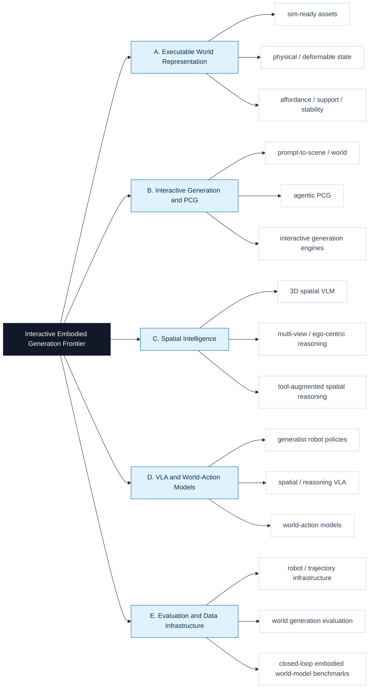

# Interactive Embodied Generation Frontier

面向 **可交互生成、具身智能、空间智能、VLA、可执行物理世界** 的 2024+ 前沿论文精读库。

这个仓库的核心不是堆论文列表，而是维护可复用的结构化精读报告：每篇最终收录论文都要说明原文链接、novelty、contribution、task、data、method、关键图/架构图、证据、局限和对我们任务的启发。

## 精读报告入口

| 内容 | 入口 |
|---|---|
| 从这里开始：精选与逐篇复审 | [paper_reads/library_review.md](paper_reads/library_review.md) |
| 层级化精读库 | [paper_reads/README.md](paper_reads/README.md) |
| 按任务阅读与更迭 | [paper_reads/task_frontiers.md](paper_reads/task_frontiers.md) |
| 最新扩库摘要 | [reports/2026-10-18-expansion.md](reports/2026-10-18-expansion.md) |
| 历史保留记录 | 168 篇；保留不表示全部继续满足新版准入 |
| 待人工决定 | `undecided/` local-only，默认不上传 |

每次 run 广泛发现候选，再精选具有实质增量的工作。run 目录只维护审计产物；最终论文精读统一沉淀到 `paper_reads/<branch>/<slug>.md`。新增可以为 0，不为周更凑数；满足全部门槛的候选仍应全部处理，不做固定 top-k 抽样。

## 2026-10-20 存量整理

已按用户要求，对全部 168 条记录重新核查来源、任务、实质增量和现有证据。
本次是存量复审，没有扩库；也没有独立训练模型或复现论文指标。

| 本次结论 | 数量 | 阅读方式 |
|---|---:|---|
| 优先阅读 | 27 | 重新满足三项四分门槛及适用证据要求，默认展开 |
| 参考备选 | 31 | 保留基础或独立价值，不表示重新通过核心准入 |
| 观察名单 | 34 | 当前增量、直接用途或证据不足，记录复查触发条件 |
| 待视觉复核 | 73 | 不再继承旧的 strong/adequate；本地保留详细 dossier |
| 来源待修复 | 3 | 原主链接与论文身份不匹配，先隔离再纠错 |

默认入口已从全量平铺改为精选阅读，其余记录折叠保留。每篇旧精读首部都显示本次结论；
原准入标签保存在 `historical_acceptance`，历史 run 不改写。不能把来源核实当作独立复现，
也不能把“未完成视觉复核”解释为论文效果差。

完整判断与来源见 [逐篇复审](paper_reads/library_review.md)，方法和问题汇总见
[整理审计](reports/reorganization/2026-10-20/summary.md)。任务级替代仍需同协议、无关键退化的证据；
本次没有据版本号或 unmatched 分数强行建立 historical 关系。

## 任务级更迭

同一任务有更强、更全面的工作时，阅读入口应随证据更新。任务视图按
`current`（当前优先阅读）、`alternative`（有独立优势的备选）、`historical`
（该任务的历史前作）和 `unreviewed`（尚未完成比较）组织论文；同一论文可以在不同任务中有不同地位。

只有任务一致、比较协议可比、改进充分且没有实质退步时，才把旧工作在该任务中标为
`historical`，关联到具体后继，并在新工作下折叠展示历史沿革。有成本、泛化、开放性或部署优势的旧工作保留为备选；证据不足不强行判定替代。`current` 不是全局 SOTA 声明，也不要求每个任务只有一篇。

原论文条目、精读文件与链接永久保留。当前所有存量记录已归入任务；`unreviewed` 表示
任务推荐尚缺比较/视觉/来源证据，不表示本次没有检查该条目。具体规则见 [harness/task_lifecycle.md](harness/task_lifecycle.md)，
任务状态保存在 [data/task_frontiers.seed.json](data/task_frontiers.seed.json)。

## 上轮扩库记录（复审前历史）

本轮扩库日期：2026-10-18。完整审计摘要见 [reports/2026-10-18-expansion.md](reports/2026-10-18-expansion.md)。

下表是当时的新增审计，不代表当前优先阅读；当前分层以上述存量复审和任务入口为准。

### 重点新增与补齐

| Paper | Branch | 简要说明 | 精读 |
|---|---|---|---|
| RoboSimStudio / AutoRSR | A | Editable contact physics and automated executable real-to-sim assets. | [paper_reads/A](paper_reads/A_executable_world_representation/README.md) |
| PhySGA / WEDGE / PAWA | B | Physics-grounded composition, weakness-guided PCG, and shared multiplayer worlds. | [paper_reads/B](paper_reads/B_interactive_generation_pcg/README.md) |
| DeSpatial / DynThinker | C | Unified metric perception and static-dynamic spatial reasoning. | [paper_reads/C](paper_reads/C_spatial_intelligence/README.md) |
| T2-z / GeoState / OneWM | D | Adaptive environment latents, view-decoupled geometry, and unified causal world-action learning. | [paper_reads/D](paper_reads/D_vla_world_action_models/README.md) |
| LIBERO-PeRM / Orbia / ForceBench / TacClaw-Infinity | E | Preference, 3D consistency, force, and tactile-data evaluation infrastructure. | [paper_reads/E](paper_reads/E_evaluation_data_infrastructure/README.md) |

### 全量收录状态

| Branch | Count | Anchor works |
|---|---:|---|
| A. Executable World Representation | 17 | SceneFun3D, PointCast, PhysLDM, FAMOS, FunArt, WonderPlay ... |
| B. Interactive Generation and PCG | 24 | WorldCast, Tetris3D, SimFoundry, AgriGen, Gamma-World, SAGE ... |
| C. Spatial Intelligence | 19 | Ledger, Vesta, SpatialBot, SpaceTools, Point-It-Out, ESI-Bench ... |
| D. VLA and World-Action Models | 61 | DreamTrue, UNITAS, RoboJEPA, Long-WAM, DepthWorld, PLaW-VLA ... |
| E. Evaluation and Data Infrastructure | 47 | LIVIN, MultiWorldBench, OpenViTac, RT-Safe, GaugeBench, BiGym 2.0 ... |

## 研究树



## 自动化 Workflow

一轮检索会生成：

- `reports/runs/YYYY-MM-DD/`：run plan、discovery、evidence、review、editor report、registry patch、manifest。
- `paper_reads/<branch>/<slug>.md`：最终收录论文的长期精读报告。
- `data/task_frontiers.seed.json`：任务范围、阅读地位与有证据的更迭关系；`paper_reads/task_frontiers.md` 为生成视图。
- `reports/YYYY-MM-DD-expansion.md`：本轮扩库摘要；主要产物仍是 `paper_reads/` 与 `data/papers.seed.json`。
- `undecided/YYYY-MM-DD/CAND-xxxx.md`：无法判断视觉/demo 质量时的本地待定精读，默认不上传。

常用命令：

```bash
python scripts/scaffold_run.py YYYY-MM-DD
python3 scripts/render_reading_indexes.py
REQUIRE_UNDECIDED_DOSSIERS=1 python scripts/validate_all.py
python scripts/publish_validated_update.py --message "Expand frontier knowledge base YYYY-MM-DD"
```

发布脚本会校验、暂存、提交并 push 非 `undecided/` 变更；待定论文需要人工确认后再单独收录。

## 收录原则

自 2026-10-20 起，新 run 使用 `acceptance_policy_version: 2`。用户已授权本次存量复审；已有记录保留，但不沿用旧结论作为新版验收证据。

- 只收录 2024 年及以后的 frontier work。
- 必须有 primary / official source，例如 arXiv、OpenReview、CVF、PMLR、官方项目页或官方 GitHub。
- 必须能回答 `data / method / task / novelty / project_relevance`。
- 最终 `impact_score >= 4`、`project_relevance_score >= 4`、`evidence_strength >= 4` 必须同时满足。影响力按技术实质和受控实验或可复用发布评价，不按引用数、热度或 venue 评价。
- 项目相关性必须指出可直接使用的接口、验证器或 baseline；仅能提取“有用字段”不足以收录。每篇新条目必须解释与库内最接近工作的实质差异；没有新增知识则更新原条目或记录 noop。
- 新的 policy-v2 条目必须指定真实任务 `task_ids` 并出现在任务视图；收录与替代分开判断。每次检查新增及相关同任务发布，按可比证据维护当前入口、备选和历史前作，不凭日期或单个榜单分数归档。
- 生成类、交互世界、物理世界、VLA demo 类工作必须实际检查视觉或交互效果并留下页码、图号或视频时间段与观察记录；页面存在视频链接不等于已观看。其他门槛已满足而视觉仍无法判断的候选进入本地 `undecided/` dossier，不能用 watchlist 代替。
- A 分支包含对象级 sim-ready 资产、关节与物理属性，不要求生成完整场景或世界。
- 普通相关论文进入轻量 watchlist，记录缺少的证据和 `revisit_trigger`，无需全部制作精读。通过全部门槛的候选仍完整收录；新增异常增长只触发复审，不按篇数截断。
- 发现阶段覆盖各分支子方向，使用 14 天首发与更新重叠窗口、45 天代码/数据/demo 发布回扫和每月 2024+ 补漏；查询与固定来源访问必须留真实可追溯记录。
- venue 不是硬门槛，效果、证据和项目相关性更重要。

详细规则见 [harness/acceptance_harness.md](harness/acceptance_harness.md)、[harness/task_lifecycle.md](harness/task_lifecycle.md) 和 [harness/system_harness.md](harness/system_harness.md)。
